  

# Hola, soy Zullie Díaz 👋

Estudiante de **Ingeniería de Software** (Uniempresarial) y desarrolladora **full stack**. Me gusta construir APIs limpias y aplicaciones web de punta a punta, con pruebas y buenas prácticas.

📍 Bogotá · ✉️ zdiaz@uniempresarial.edu.co

## 🎮 Power-ups (tecnologías)

También: Angular, Java y Spring Boot, Firebase Auth. Intereses: arquitectura, acceso remoto y ciberseguridad.

## 🗺️ Niveles (proyectos destacados)

| Nivel | Proyecto | Tipo | Qué demuestra |
|---|---|---|---|
| 1-1 | [**api_clinica**](https://github.com/zulnidi/api_clinica) | Back (FastAPI) | Arquitectura hexagonal, JWT, 49 pruebas, CI |
| 1-2 | [**express01**](https://github.com/zulnidi/express01) | Back (Express + Mongo) | Capas, zod, OpenAPI, 38 pruebas, CI |
| 2-1 | [**al_ritmo_mern**](https://github.com/zulnidi/al_ritmo_mern) | Full stack (MERN) | API en capas + cliente React reutilizable, 53 pruebas |
| 2-2 | [**todo_app_react**](https://github.com/zulnidi/todo_app_react) | Front (React) | Dominio puro, reducer con deshacer, 30 pruebas |
| 2-3 | [**react_notes**](https://github.com/zulnidi/react_notes) | Front (React + TS) | TypeScript estricto, genéricos, 24 pruebas |
| 3-1 | [**GestionTiempoBack**](https://github.com/zulnidi/GestionTiempoBack) | Back (Django + PostgreSQL) | Repositorios y servicios, secretos por entorno |
| 3-2 | [**backend_cloud_native**](https://github.com/zulnidi/backend_cloud_native) | Back (Django + Firebase + Mongo) | Autenticación con Firebase, MongoDB Atlas |

## 💼 Experiencia

- **NESS** (ene–jul 2026): desarrollo y soporte en un entorno de ciberseguridad. Proyecto de acceso remoto con Python, Django, React, Angular, Git y GitHub.
- **FUSOFT** (ene–jul 2025): investigación en IA y tecnologías emergentes, herramientas No-Code y documentación técnica.

## 🎯 Misión actual

Buscando mi **práctica empresarial 2027-1** (18 dic – 9 jul) en desarrollo de software, remoto o híbrido, y subiendo de nivel mi inglés (B1).

## 📫 Contacto

Escríbeme a **zdiaz@uniempresarial.edu.co** o abre un issue en cualquiera de mis repositorios.
